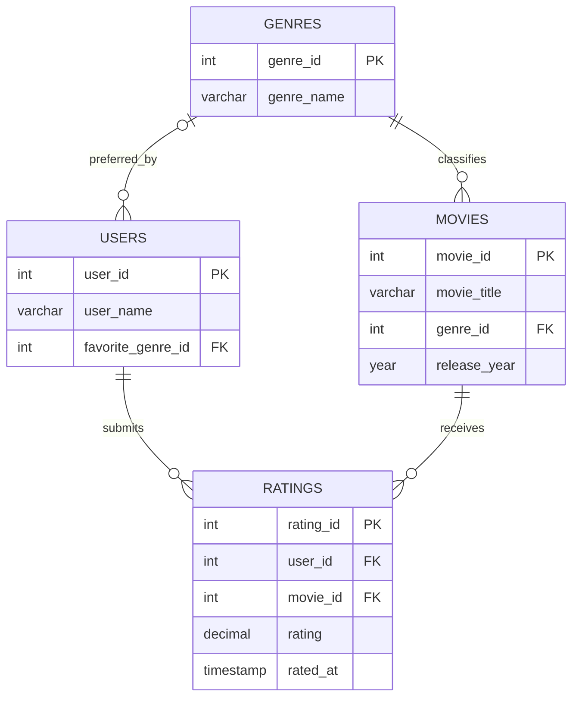

# Movie Recommendation Data Engine Using MySQL

## Project Overview

The Movie Recommendation Data Engine is a database project developed using MySQL. It stores and manages movie information, genres, user preferences, and ratings. SQL queries are used to recommend movies based on users' favorite genres and analyze ratings.

## Objectives

- Design a relational database for movie information.
- Store users, genres, movies, and ratings.
- Recommend unrated movies that match a user's favorite genre.
- Identify top-rated movies and popular genres.
- Generate reports using SQL queries.
- Practice relational database design and SQL.

## Technologies Used

- MySQL 8.0+
- MySQL Workbench
- SQL
- Git and GitHub

## Database Structure

The project contains four tables:

| Table | Description |
|---|---|
| `users` | Stores user details and favorite genre |
| `genres` | Stores genre names |
| `movies` | Stores movie titles, genres, and release years |
| `ratings` | Stores user ratings for movies |

### Entity Relationship Diagram



## Features

- Store and retrieve movie details.
- Classify movies by genre.
- Store user favorite genres.
- Recommend movies matching a user's favorite genre that the user has not rated.
- Calculate average movie ratings.
- Identify popular genres by rating count.
- Analyze user rating activity.
- Display top-rated movies.
- Generate a complete ratings report.

## SQL Concepts Used

- Database and table creation
- Primary keys and foreign keys
- `INSERT` and `SELECT`
- `WHERE` and `ORDER BY`
- `INNER JOIN` and `LEFT JOIN`
- Aggregate functions: `AVG()`, `COUNT()`, `MAX()`
- `GROUP BY` and `HAVING`
- Subqueries and `NOT EXISTS`
- `LIMIT`
- Common Table Expressions (CTEs)
- Constraints: `UNIQUE`, `NOT NULL`, and `CHECK`

## How to Run the Project

### Prerequisites

1. Install MySQL Server 8.0 or a compatible version.
2. Install MySQL Workbench.
3. Download or clone this repository.

### Steps

1. Clone the repository:

   ```bash
   git clone https://github.com/YOUR-USERNAME/movie-recommendation-data-engine.git
   ```

2. Open MySQL Workbench and connect to your MySQL server.
3. Open the project's `.sql` file in a SQL editor.
4. Execute the script.
5. Verify the database and tables:

   ```sql
   USE movie_engine;

   SHOW TABLES;

   SELECT * FROM users;
   SELECT * FROM genres;
   SELECT * FROM movies;
   SELECT * FROM ratings;
   ```

6. Run the problem-statement queries individually to view the results.

> **Warning:** If the setup script contains `DROP DATABASE IF EXISTS movie_engine`, it will delete the existing `movie_engine` database and its data before recreating it. Back up any data you need before running the script.

## Sample Problem Statements

1. Display all movies with their genres.
2. Find movies released after 2020.
3. Calculate the average rating of each movie.
4. Find the highest-rated movies.
5. Recommend movies based on users' favorite genres.
6. Count movies in each genre.
7. Find users who have rated more than one movie.
8. Identify the most popular genre by number of ratings.
9. Display the top three movies by average rating.
10. Generate a complete user rating report.

## Expected Outcomes

- Retrieve movie details by genre and release year.
- Recommend movies based on stored genre preferences.
- Analyze average ratings and rating counts.
- Identify popular genres and active users.
- Generate useful reports from relational data.

## Limitations

The current project uses rule-based, genre-based recommendations. It does not use machine learning or collaborative filtering. Recommendations depend on the favorite genre and rating data stored in the database.

## Future Enhancements

- Add actors, directors, and production details.
- Implement collaborative-filtering recommendations.
- Build a web interface for searching and rating movies.
- Integrate Python for advanced recommendation algorithms.
- Create dashboards for rating and genre analytics.

## Author

**Your Name**

GitHub: `https://github.com/YOUR-USERNAME`

## License

This project is intended for educational purposes. Add a license file if you plan to distribute the project under a specific license.
